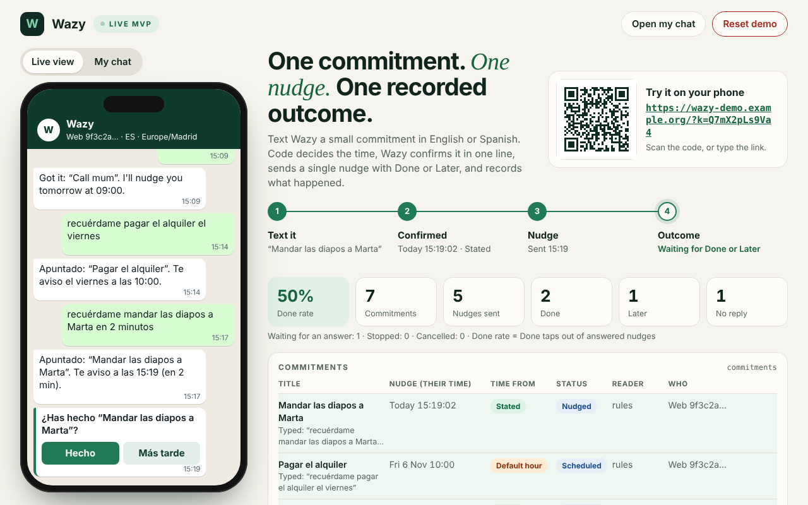
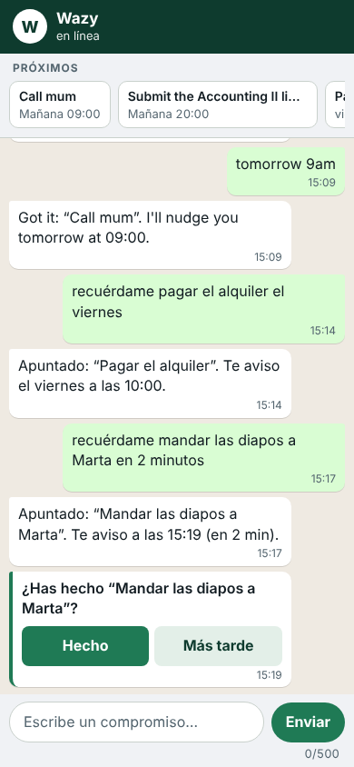

# Wazy

**Text a small commitment. Get one nudge at the right moment. Every outcome is recorded.**

Launching AI Native Ventures (ESADE, lecturer Anupam) · Andrea Di Segni and David García · version 2, 3 November 2026



## What Wazy is

Wazy is a contact you text a small commitment to, like "send Marta the slides by Thursday". It answers in one line with exactly when it will nudge you. At that time it sends **one** nudge with two buttons, **Done** and **Later**, and it records what you did. It works in English and Spanish, in a web chat and on WhatsApp (through Twilio).

It is the thinnest slice of Wazy that tests our riskiest guess:

> **Guess 1.** We believe that one proactive nudge per commitment will get busy people to follow through on small promises without feeling nagged. We will know we are right when test users text new commitments on 3+ different days and tap **Done** on at least half of their nudges.

### The eight promises

These hold everywhere in the code, and the tests check them (full wording in [SPEC.md](SPEC.md), section 0).

1. **Code decides when.** Rules in code read the time. The optional AI may tidy a title. It may suggest a time only when the rules found no time at all, and code checks that time like any other. An AI answer can never trigger anything else.
2. **One commitment, one nudge, one recorded outcome.** The outcome is `done`, `later`, `stop`, `no_reply` (nothing after 24 hours) or `cancelled`. Later schedules exactly one more nudge.
3. **Nothing is deleted.** Cancel and STOP change a status. The only action that touches many commitments at once is STOP, and only the person can send it.
4. **Learning asks first.** Wazy may suggest a better default hour. Nothing changes until the person says YES. A time the person gave is never changed, and a learned hour never moves a deadline later.
5. **Fail closed.** A setting that is present but wrong stops the server from starting, with a message that names the setting.
6. **Say what went wrong.** When Wazy cannot use a time, it says why in plain words (not a real time, already passed, repeating, two commitments at once, more than a year away) and asks one clear question. It never silently guesses.
7. **Titles are clean.** The title is only the task. No time words, no vague words like "at some point", no "remind me to" or "please", and never an instruction aimed at Wazy.
8. **Private by default.** Message text is never written to the logs. Each person only ever sees their own data.

## Quick start (60 seconds, on David's Mac)

Wazy needs **Python 3.9 or newer** and nothing else. No packages, no keys. A Mac with the Xcode command line tools already has Python 3.9.6.

```bash
cd wazy-mvp
python3 --version     # 3.9 or newer
./run.sh              # or: python3 -m wazy
```

1. Open **http://127.0.0.1:8765/demo**. This is the presenter view: the chat in a phone frame, the four steps, the stats and the tables.
2. Switch the phone to **My chat** (or open http://127.0.0.1:8765/ in another tab).
3. Type `Send Marta the slides in 30 seconds`. Wazy confirms the exact time.
4. Thirty seconds later the nudge arrives with **Done** and **Later** (**Hecho** and **Más tarde** in Spanish).
5. Tap **Done**. The row in the outcome log shows the outcome and how many seconds you took.

For a live demo of Later, start with `WAZY_LATER_MINUTES=1 ./run.sh`, so the extra nudge comes back after one minute instead of the next morning.

**On phones:** install the tunnel tool once (`brew install ngrok`, then `ngrok config add-authtoken <token>` from a free ngrok account). Then start with:

```bash
./run.sh --phone
```

A QR code appears on the presenter view. Scanning it opens the chat with the access code built in.

To clear the demo, press **Reset demo** on the presenter view (it asks first, and the access code stays). Stop the server with **Ctrl + C**. If a setting is wrong, Wazy does not start and prints `[wazy] Not starting:` with the reason.

## How testers use it

- A tester opens the link once: the QR code, or `https://<your-address>/?k=<access code>`. Without the code they only see a page that says "scan the QR code".
- On that first visit the code moves into a cookie (it lasts 30 days) and is taken out of the address bar. The browser also gets its own random id in a second cookie (it lasts a year). Both cookies are HttpOnly, so the page's scripts cannot read them.
- **Each browser gets its own conversation.** The random id is the person (`web:<id>`), so every tester has their own chat, commitments, outcomes and learning. Nobody sees anyone else's messages.
- The same person on a second browser, in a private window, or after clearing cookies, starts a new conversation.
- On this computer every tab is the same person, `web:local`.
- The presenter view shows everyone. Its **Live view** follows the person who was active most recently, and the **People** table lists every tester.
- The web chat has no notifications. A tester sees a nudge when the chat page is open. WhatsApp is the real channel for the user test.



## WhatsApp through Twilio

WhatsApp is off until the Twilio settings are there. Then the startup message shows WhatsApp as on.

### 1. What you need

- A Twilio account with a WhatsApp sender. For a first try, Twilio's WhatsApp sandbox works (each tester first sends the sandbox's join message to it).
- Wazy reachable at a public **https** address. That is a hosting platform (see "Putting it online"), or the tunnel from `./run.sh --phone` (the free tunnel address changes every run, so the webhook must be updated each time).

### 2. The settings

Put these in `.env` (copy `.env.example` first). The three Twilio settings go together: all three or none.

```bash
TWILIO_ACCOUNT_SID=<AC and 32 hex characters, from the Twilio console>
TWILIO_AUTH_TOKEN=<32 hex characters, from the Twilio console>
TWILIO_WHATSAPP_FROM=whatsapp:+14155238886
WAZY_PUBLIC_URL=https://wazy.example.com
TWILIO_CONTENT_SID=<HX and 32 hex characters, optional>
```

Replace each value with your own. `TWILIO_CONTENT_SID` is optional (see step 4).

### 3. The webhook

In Twilio, set "when a message comes in" for your WhatsApp sender to:

```
https://<your-address>/whatsapp/webhook
```

with method **POST**. `WAZY_PUBLIC_URL` must be exactly the address Twilio calls, because Twilio signs that address together with the message. If they differ, every message is refused with 403 and Wazy does nothing.

What happens to a message coming in:

1. Wazy checks Twilio's signature. A wrong or missing signature gets 403.
2. A message Twilio already sent before (same message id) is ignored.
3. The sender's number becomes the person, like `whatsapp:+34600000000`. A new person's time zone comes from the country code: +34 Madrid, +44 London, +39 Rome, +33 Paris, +49 Berlin, +351 Lisbon, +41 Zurich, +31 Amsterdam, +32 Brussels, and anything else gets `WAZY_TZ`.
4. Wazy answers Twilio's request with an empty reply. Its own messages go out separately, through the outbox.

**The outbox.** Every message Wazy stores for a WhatsApp person becomes a row in the `outbox` table. A background sender looks for due rows every 2 seconds and posts them to Twilio. A failed send is tried again after 30 seconds, 2 minutes, 10 minutes and 1 hour. After 5 attempts the row is marked `failed`. An error that cannot get better (a wrong number, wrong credentials) fails at once. A row is never sent twice. A nudge still waiting in the queue is not sent if the person has since said STOP, cancelled it or answered it.

### 4. Done and Later buttons (Content Template)

Without `TWILIO_CONTENT_SID`, a nudge is plain text that ends with "Reply DONE or LATER" ("Responde HECHO o MÁS TARDE" in Spanish). With it, Wazy sends every nudge through a Twilio **Content Template** with two quick-reply buttons. To make one in Twilio's Content Template Builder:

- choose a quick-reply template
- write a body with one variable, `{{1}}`, which Wazy fills with the task title, for example `⏰ Nudge: {{1}}`
- add two buttons, **Done** and **Later**
- send it to WhatsApp for approval (you need that for nudges outside the 24-hour window, below)
- copy its id (`HX` and 32 characters) into `TWILIO_CONTENT_SID`

When someone taps a button, Twilio sends the button's words back. Wazy reads "Done" or "Later" just like the typed word, so it answers that person's newest open nudge. If a button's id has the form `done:12` or `later:12`, Wazy answers commitment 12 exactly. Any other id falls back to the words. A Spanish speaker who taps "Done" keeps getting Spanish replies, because "done" does not count as a sign of English.

### 5. The 24-hour window

WhatsApp lets a business send free-form messages only within 24 hours of the person's last message. Outside that window, only an approved template gets through.

- Wazy's replies answer a message the person just sent, so they are inside the window.
- A nudge can come days later. With an approved Content Template it can go out at any time. Without one, it reaches the person only if they wrote to Wazy in the last 24 hours.
- The learning question (sent after a nudge gets no reply) is always plain text, so it has the same limit.
- Wazy marks a row `sent` once Twilio accepts it. It does not hear back about delivery yet, so a message that WhatsApp refuses later still shows as sent.

This is the Session 7 lesson: in six months with the old Wazy, only one reminder reached David without him writing first. For the user test, every nudge must use an approved template.

## Settings

All optional. Copy `.env.example` to `.env` to change them. Real environment variables win over `.env`. A setting that is present but wrong stops Wazy from starting.

| Variable | Default | What it does |
|---|---|---|
| `WAZY_HOST` | `127.0.0.1` | Address to listen on. `127.0.0.1` is this computer only. Use `0.0.0.0` on a hosting platform. |
| `WAZY_PORT` | `8765` | Port, 1 to 65535. |
| `PORT` | empty | Used when `WAZY_PORT` is empty. Hosting platforms set it for you. |
| `WAZY_TZ` | `Europe/Madrid` | The time zone new people start in (web testers, and WhatsApp numbers from other countries). Must be a real zone name. |
| `WAZY_DB` | `data/wazy.db` | The SQLite file. Created if missing. A v1 file is copied to a backup and upgraded automatically. |
| `ANTHROPIC_API_KEY` | empty | Switches on the optional Claude Haiku title tidier. Must start with `sk-ant-`. The rules still decide every time. |
| `WAZY_AI_MODEL` | `claude-haiku-4-5-20251001` | The model the title tidier uses. |
| `WAZY_LATER_MINUTES` | empty | Minutes until the extra nudge after Later, 1 to 1440. Empty means the next morning at the person's usual hour. Try `1` for a live demo. |
| `WAZY_ACCESS_CODE` | generated | The code other browsers need once (`/?k=CODE`). At least 8 letters, digits, `-` or `_`. If empty, Wazy makes one and keeps it in the database. |
| `WAZY_ADMIN_CODE` | empty | Lets another computer open the presenter view (`/demo?admin=CODE`). At least 12 letters, digits, `-` or `_`, and different from the access code. Empty means the presenter view works on this computer only. |
| `WAZY_PUBLIC_URL` | empty | The plain https address people reach this server at, like `https://wazy.example.com`. Required with WhatsApp, because Twilio signs its webhooks with it. Also used for the QR code. |
| `TWILIO_ACCOUNT_SID` | empty | `AC` followed by 32 hex characters. |
| `TWILIO_AUTH_TOKEN` | empty | 32 hex characters. Used to send messages and to check that webhooks really come from Twilio. |
| `TWILIO_WHATSAPP_FROM` | empty | The WhatsApp sender, written `whatsapp:+` and the number's digits, like `whatsapp:+14155238886`. |
| `TWILIO_CONTENT_SID` | empty | Optional Content Template with Done and Later buttons: `HX` followed by 32 hex characters. Only with the three Twilio settings above. |

## What people can text

A command counts only when it is the **whole** message, so "stop smoking tomorrow" or "cancel my dentist appointment on Friday" are commitments. Small extras are fine around a command: "stop please", "done, thanks", "hola wazy".

| English | Spanish | What happens |
|---|---|---|
| a commitment, like `call mum tomorrow at 9am` | `recuérdame llamar a mamá mañana a las 9` | Wazy confirms the title and the exact nudge time, or says what is wrong with the time and asks one question. |
| `stop`, `unsubscribe me` | `para`, `basta`, `deja de avisarme` | Every upcoming nudge stops and Wazy sends nothing more. Nothing is deleted. |
| `start` | `empezar`, `reanudar` | Nudges are back on. Texting a new commitment does this too. |
| `help` | `ayuda` | The list of commands. |
| `hi` | `hola` | The welcome message. |
| `done` | `hecho`, `listo` | Answers your newest open nudge with Done (the same as the button). |
| `later` | `más tarde`, `luego` | Answers it with Later: one more nudge, by default the next morning at your usual hour. |
| `list`, `show me my list` | `lista`, `qué tengo` | Your next 10 upcoming commitments, numbered, soonest first. |
| `cancel 2`, `cancel 1 and 3` | `cancela 2`, `borra 2`, `cancela 1 y 3` | Cancels those numbers of the list you saw last. If one number is not on the list, nothing is cancelled and Wazy shows the list. |
| `cancel`, `cancel all` | `cancela`, `cancela todo` | Drops the question Wazy is waiting on. Otherwise it cancels your only upcoming commitment, or asks which one. |
| `never mind`, `skip` | `olvídalo`, `da igual`, `déjalo` | Only while Wazy is waiting for a missing time or task: drops that question. |
| `what did you learn` | `qué has aprendido` | Explains what Wazy noticed about your timing, with the real numbers. |
| `forget` | `olvida` | Wipes the learned hour and stops learning until `learn again`. While Wazy is waiting for a time, it drops that question instead. |
| `learn again` | `vuelve a aprender` | Turns learning back on. Wazy still asks before changing anything. |
| `yes` / `no` | `sí`, `vale` / `no` | Only right after Wazy's learning question: approve or refuse the new hour. |

Wazy also answers, without creating a commitment, when a message is a question ("do you speak Spanish?"), a request to change a reminder ("move it to 5", which it cannot do yet: cancel and send it again), or an instruction aimed at Wazy ("ignore your rules ..."). It always answers in the person's language.

**When a time is wrong, Wazy says why.** Examples of what it reads as a problem:

| The person writes | Wazy says |
|---|---|
| `Call mum at 25:00` | "25:00" is not a real time, then asks when to nudge about "Call mum" |
| `Call mum yesterday` | "yesterday" has already passed, then asks when |
| `Water the plants every Monday` | it nudges once per commitment, so it cannot repeat, and asks for one time |
| `Call mum at 5 and email Bob tomorrow` | that looks like two commitments, so send one at a time |
| `Renew passport on 5 Dec 2028` | that is more than a year away |
| `Dentist Monday 5 Nov` (5 Nov 2026 is a Thursday) | the date does not match the calendar, that date is a Thursday |
| `Sort out the gym thing at some point` | asks when, with the title "Sort out the gym thing" |

For a time that is impossible, already passed, too far away or missing, Wazy keeps the task and waits for two hours. The next message with a good time ("tomorrow 9am") then creates the commitment with the clean title, and the problem is saved in `reader_misses` with the reply that fixed it. A repeating time or two commitments in one message are not kept: the person sends the commitment again, with one time.

## Tests and evals

```bash
python3.9 -m unittest discover -s tests     # unit, fuzz and concurrency tests
python3.9 evals/run.py                      # every eval case, writes evals/REPORT.md
python3.9 evals/compare_v1.py               # the same cases on v1 and on v2
```

On a Mac where `python3 --version` already says 3.9, `python3` works the same.

- **Tests** (`tests/`, more than 900): one file per module, plus `test_fuzz.py`, which sends thousands of generated messages from several people and eight threads at once and checks the eight promises after every step.
- **Evals** (`evals/cases/`, more than 600 cases in 13 files): short scripted conversations, each with what should be true at the end. `run.py` plays each one against a fresh Wazy with a frozen clock, then reports the pass rate by category and by **which step fails most often** (crash, intent, time, title, language, reply or flow). See [evals/README.md](evals/README.md).
- **Before and after**: `compare_v1.py` takes v1 straight from git (tag `pre-rewrite-2026-11-03`) into a temporary folder and runs the same cases on both versions. It scores only the end result (which commitments, with what title and time), because v1 never said why it could not use a time. The numbers are at the top of [evals/REPORT.md](evals/REPORT.md).

## Putting it online

Wazy needs a hosting platform that keeps one process running, not a serverless one, because the scheduler is a loop inside the server.

- Start command `python3 -m wazy`, with `WAZY_HOST=0.0.0.0`. The port comes from `PORT`.
- `WAZY_DB` on a persistent disk, or every outcome is lost at each deploy.
- `WAZY_PUBLIC_URL` set to the https address, a fixed `WAZY_ACCESS_CODE`, and a `WAZY_ADMIN_CODE` to open the presenter view from your laptop.
- `GET /healthz` answers `{"ok": true}` for uptime checks, with no login and no data.
- The access link is printed only when a person is watching a terminal, so it never ends up in the platform's logs.

## Files

| File | What it does |
|---|---|
| `wazy/__main__.py` | `python3 -m wazy`: reads the settings, then starts the server |
| `wazy/config.py` | Every setting, checked at start. A bad one stops Wazy (fail closed) |
| `wazy/server.py` | The web server: chat, presenter view, JSON API, WhatsApp webhook, access rules, rate limit |
| `wazy/app.py` | The App: the one object the server, WhatsApp, the tests and the evals talk to |
| `wazy/conversation.py` | The conversation state machine: what Wazy does with each message and each Done or Later tap |
| `wazy/intents.py` | What kind of message it is: a command, a question, an edit, an injection, or a commitment |
| `wazy/lang.py` | English or Spanish, from word clues |
| `wazy/timeparse.py` | The rules that turn words into one exact time, or say what is wrong with it |
| `wazy/title.py` | The clean task title: time words, vague words and filler removed |
| `wazy/replies.py` | Every sentence Wazy says, in English and Spanish, and the "tomorrow at 09:00" wording |
| `wazy/ai.py` | The optional Claude Haiku title tidier, with code checks on everything it returns |
| `wazy/scheduler.py` | Sends each nudge once, closes unanswered ones after 24 hours, times the nudge after Later |
| `wazy/learning.py` | The learning rule: notices a better hour and asks before changing anything |
| `wazy/whatsapp.py` | Twilio in and out: signature check, duplicate check, outbox with retries |
| `wazy/db.py` | SQLite tables, UTC times, and the automatic upgrade from v1 |
| `wazy/types.py` | The shared data types every module uses (`TimeResult`, `Intent`, `Reply`) |
| `wazy/static/` | `chat.html` (the phone) and `demo.html` (the presenter view) |
| `tests/` | Unit, fuzz and concurrency tests, one file per module |
| `evals/` | `run.py`, `compare_v1.py`, the cases, their README and `REPORT.md` |
| `run.sh` | Starts Wazy, and with `--phone` also the tunnel |
| `.env.example` | Every setting, explained. Copy it to `.env` |
| `docs/` | Screenshots |

## Privacy

**What is stored**, in the SQLite file only (the `data/` folder is git-ignored):

- each person's id: a random browser id, or their WhatsApp number
- their language, time zone, whether they said STOP, and the hour they approved, if any
- every message they send and every reply, because the chat and the outcome log need them
- their commitments (exactly what they typed, and the title), each nudge's outcome and response time, the learning log, and `reader_misses` (messages whose time Wazy could not use, with the reply that fixed it)
- for WhatsApp, the outbox (status, Twilio's message id, a short error code) and the ids of Twilio messages already handled

**Nothing in the logs.** Message text is never printed. Phone numbers appear only as their last 3 digits. Errors are logged by type only. Request lines are not printed, because a link can hold the access code.

**Who else sees text.** On WhatsApp, Twilio and WhatsApp carry the messages. With `ANTHROPIC_API_KEY` set, messages read as commitments are also sent to Anthropic to tidy the title, and Wazy's welcome says so. Without the key and without WhatsApp, Wazy sends message text to no other service. (With `./run.sh --phone`, the tunnel service carries the phones' traffic.)

**Each person sees only their own data.** The presenter view sees everyone, so it opens only on this computer or with the admin code.

**STOP** ends every upcoming nudge, closes open nudges as `stop`, and Wazy sends that person nothing more, not even a nudge already queued for WhatsApp. Nothing is deleted. `start`, or a new commitment, turns nudges back on. There is no command yet that deletes one person's data. The presenter's Reset deletes everyone's.

## Known limits (honest list)

- WhatsApp is built and tested against a stand-in for Twilio in our tests. It still has to carry real testers' messages on our own number.
- No delivery receipts from WhatsApp yet (see the 24-hour window).
- The web chat has no notifications, and a tester's identity is a cookie, so a new browser means a new conversation.
- A person's time zone is set when they first write, and there is no command yet to change it.
- No recurring commitments, no editing (cancel and send again), one commitment per message. These are cut on purpose ([scope.md](scope.md)).
- The rules only understand the phrasings we wrote rules for. The evals are written from the spec, so a 100% pass rate overstates. The fair number is on real testers' messages, which `reader_misses` collects.
- The learning loop has only run in tests and simulations, not on real users. It learns one thing, the default hour, from simple counts.

## More documents

- [SPEC.md](SPEC.md): the full behaviour contract every module is built and tested against
- [CODE_TOUR.md](CODE_TOUR.md): a walk through every module in plain words
- [architecturedoc.md](architecturedoc.md): principles, stack, trade-offs, assumptions and the session log
- [evals/REPORT.md](evals/REPORT.md): the latest eval run and the before and after numbers
- [evals/README.md](evals/README.md): how the evals work and how to add a case
- [scope.md](scope.md): what the MVP does and deliberately does not do
- `Wazy MVP - Explainer.pdf`: the five-page explainer from Session 6 (describes v1)
